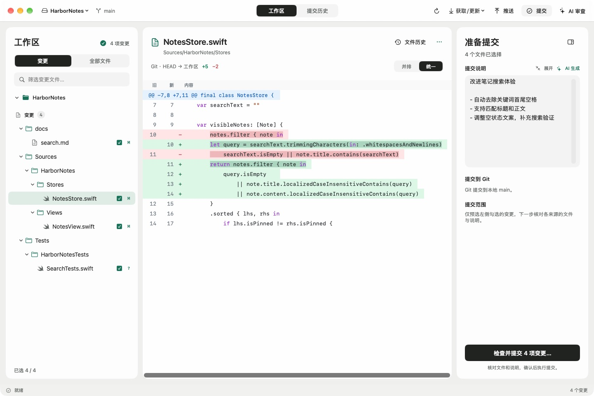
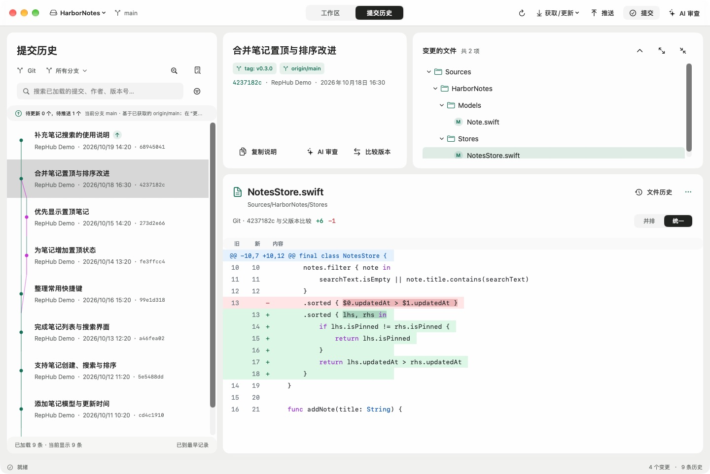

<p align="center">
  
</p>

<h1 align="center">RepHub</h1>

<p align="center">在 Mac 上管理 Git 与 SVN。</p>

<p align="center">
  <a href="#安装">安装</a> ·
  <a href="#主要功能">功能</a> ·
  <a href="#开始使用">开始使用</a> ·
  <a href="#文档">文档</a> ·
  <a href="https://github.com/520zym/RepHub/issues">反馈</a>
</p>

RepHub 是一款 macOS 原生 Git / Subversion 客户端，面向同时维护两种版本控制系统的开发者。它把工作区、代码差异和提交历史放在一起，并提供带预览和中断恢复的 SVN → Git 迁移。

当前版本 **0.0.1**，需要 **macOS 26 或更新版本**。



*工作区：按文件选择变更，阅读带语法高亮的差异，并准备提交说明。本文截图均来自 RepHub 原生应用，使用独立的本地演示仓库与虚构作者。*

## 主要功能

| 功能 | 可以做什么 |
| --- | --- |
| 仓库与工作区 | 打开本地仓库、克隆 Git、浏览并检出 SVN 子目录；识别同一目录中的 Git + SVN，也可关联其他工作副本。 |
| 文件与代码差异 | 切换变更 / 全部文件，按真实目录层级浏览；使用并排或统一差异、行号、语法高亮与独立代码配色。 |
| 提交与历史 | 按文件核对提交范围，分别向 Git、SVN 提交；浏览 Git 图谱、分支与标签，搜索历史、查看文件历史和比较两个版本。 |
| 仓库操作 | Git 获取、快进更新、推送、暂存及分支合并；SVN 更新与提交；按工具能力提供本地改动和冲突处理入口。 |
| SVN → Git 迁移 | 保留可读取的历史或迁移单个快照，核对文件、作者与修订映射；支持新目录、当前工作副本迁移及初次迁移的检查点恢复。 |
| 可选 AI 辅助 | 为所选变更生成提交说明，审查工作区或历史提交；接入模型 API、Codex CLI 或 Claude Code。 |
| 原生体验 | 多窗口、最近打开、可调整分栏；应用主题、浅色 / 深色 / 跟随系统与代码配色分别设置并持久化。 |



*提交历史：沿 Git 图谱阅读分支与合并记录，选择提交后查看文件和差异。*

## 安装

从 [GitHub Releases](https://github.com/520zym/RepHub/releases/latest) 下载 DMG：Apple Silicon（M 系列）选择 `arm64`，Intel 选择 `x86_64`。打开安装包，将 RepHub 拖入“应用程序”后启动。每个安装包附带 SHA-256 校验文件。

安装包需要 macOS 26 或更新版本，使用临时签名，尚未经过 Apple 公证。

### 从源码构建

需要 Xcode 26 或更新版本，以及本地 `git`。使用 SVN 功能还需安装 `svn`；工具会从常见安装目录和当前 `PATH` 查找。

```sh
git clone https://github.com/520zym/RepHub.git
cd RepHub
./scripts/build-app.sh release
open build/RepHub.app
```

也可以用 Xcode 打开 `Package.swift` 进行开发。

### 生成 DMG 安装包

```sh
./scripts/build-dmg.sh
```

安装包与 SHA-256 校验文件输出到 `build/dist/`，使用构建机器的架构。打开 DMG，将 RepHub 拖入“应用程序”后启动。

旧 SVN 服务的 TLS 兼容条件见 [SVN TLS 兼容说明](docs/svn-tls-compatibility.md)。

## 开始使用

1. 按 **⌘O** 打开仓库，选择本地文件夹，或从远程克隆 / 检出。**⇧⌘O** 可在新窗口打开。
2. 在“工作区”选择变更文件并查看差异。同一目录有多个版本控制来源时，先选定 Git 或 SVN。
3. 填写提交说明，点击“提交”，在准备窗口核对各目标的文件与说明后确认。**Git 提交写入本地，推送是独立操作；SVN 提交直接写入服务器。**
4. 按 **⌘2** 查看提交历史，按 **⌘1** 返回工作区；按 **⌘,** 打开设置。

菜单按任务划分：“文件”管理窗口与打开入口，“显示”切换视图，“仓库”提供提交、更新、推送、比较和迁移。详见 [菜单与功能入口](docs/menu-organization.md)。

### 将 SVN 项目迁移到 Git

从 **仓库 → SVN → Git 迁移** 进入，选择迁入新目录，或为当前 SVN 工作副本保留 `.svn` 并建立 Git 管理。首次迁移的目标需要是空 Git 仓库。

转换后先预览文件、历史和修订映射，确认后再应用或发布。中断的初次迁移可从“继续已有迁移”选择保留的记录，复用检查点中已经转换的提交。当前工作副本模式还支持显式补迁后续 SVN 提交；这不是持续双向同步。完整流程与限制见 [迁移说明](docs/repository-migration.md)。

### 配置 AI 辅助

在 **RepHub → 设置 → AI 与场景** 中配置 API 或本机 CLI，再从提交准备窗口生成说明，或点击“AI 审查”。API 密钥保存在 macOS 钥匙串；调用时会将所选文件的差异交给配置的服务或工具，结果由你核对，RepHub 不会据此自动提交。支持的连接和配置方式见 [AI 使用说明](docs/ai.md)。

## 文档

| 我想了解… | 文档 |
| --- | --- |
| 菜单和功能在哪里 | [菜单与入口](docs/menu-organization.md) |
| 如何选择提交范围、分别提交 Git / SVN | [提交代码](docs/committing.md) |
| 文件历史、改名追踪与同步状态 | [文件历史](docs/file-history.md) |
| 获取、更新、取消与冲突行为 | [仓库更新](docs/repository-update.md) |
| 初始化、分支、推送与关联工作副本 | [仓库管理](docs/repository-management.md) |
| 迁移预览、检查点恢复与补迁 | [SVN → Git 迁移](docs/repository-migration.md) |
| AI 连接、场景、代码范围与用量 | [AI 配置](docs/ai.md) |

## 开发

项目使用 SwiftUI、AppKit 和 Swift Package Manager。版本控制契约独立于 Git / SVN 适配器，业务层与界面依赖抽象，由应用入口组装；AI 也使用独立的契约、编排与适配模块。模块职责见 [原生架构](docs/native-architecture.md)。

```sh
# 运行测试；本地 SVN 集成测试另需 svnadmin
swift test

# 构建调试版应用
./scripts/build-app.sh
```

自动化测试和界面验收使用隔离的临时仓库。功能的验证范围与已知边界见 [原生验证记录](docs/native-verification.md)，完整需求见 [需求文档](docs/requirements.md)。构建产物位于 `.build/` 和 `build/`，不纳入版本控制。

推送 `0.0.1` 这样的版本标签后，GitHub Actions 自动测试、打包并发布两种架构的 DMG。标签与应用版本必须一致；也可手动运行流水线，仅构建安装包。操作步骤见 [打包与发布](docs/releasing.md)。

## 反馈

欢迎通过 [GitHub Issues](https://github.com/520zym/RepHub/issues) 提交问题或建议。报告问题时请附上 RepHub / macOS 版本、使用的 Git 或 SVN、复现步骤，以及预期和实际结果。截图和日志中请隐去个人信息、凭据及私有仓库地址。
