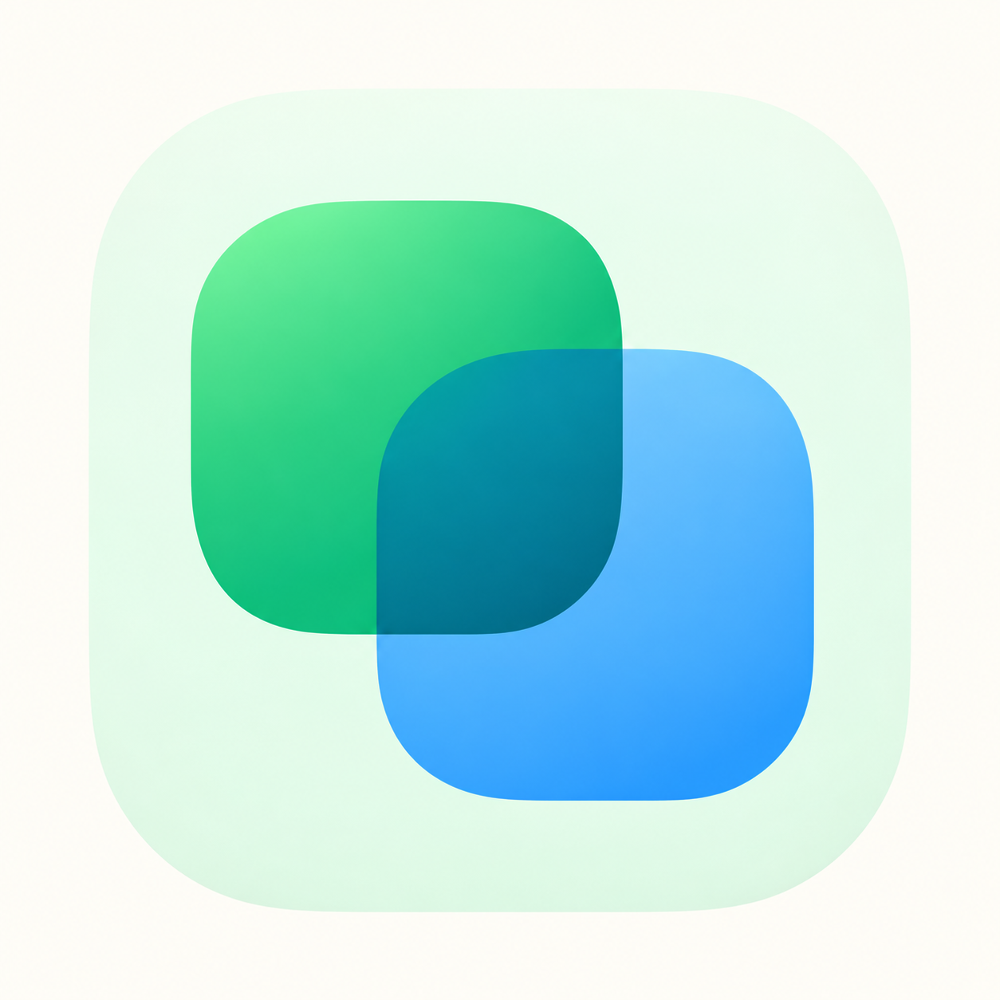
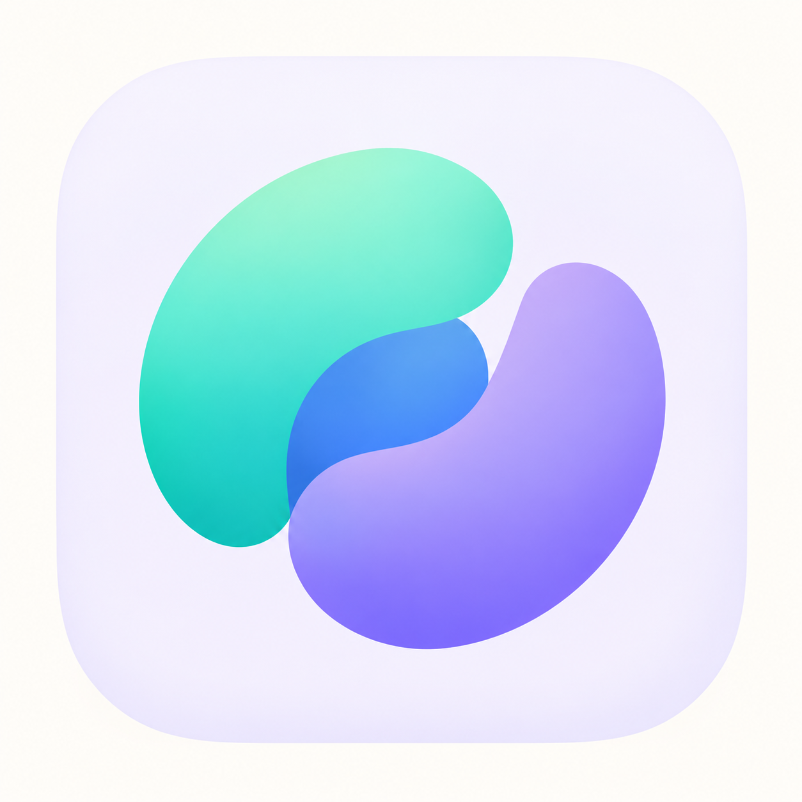
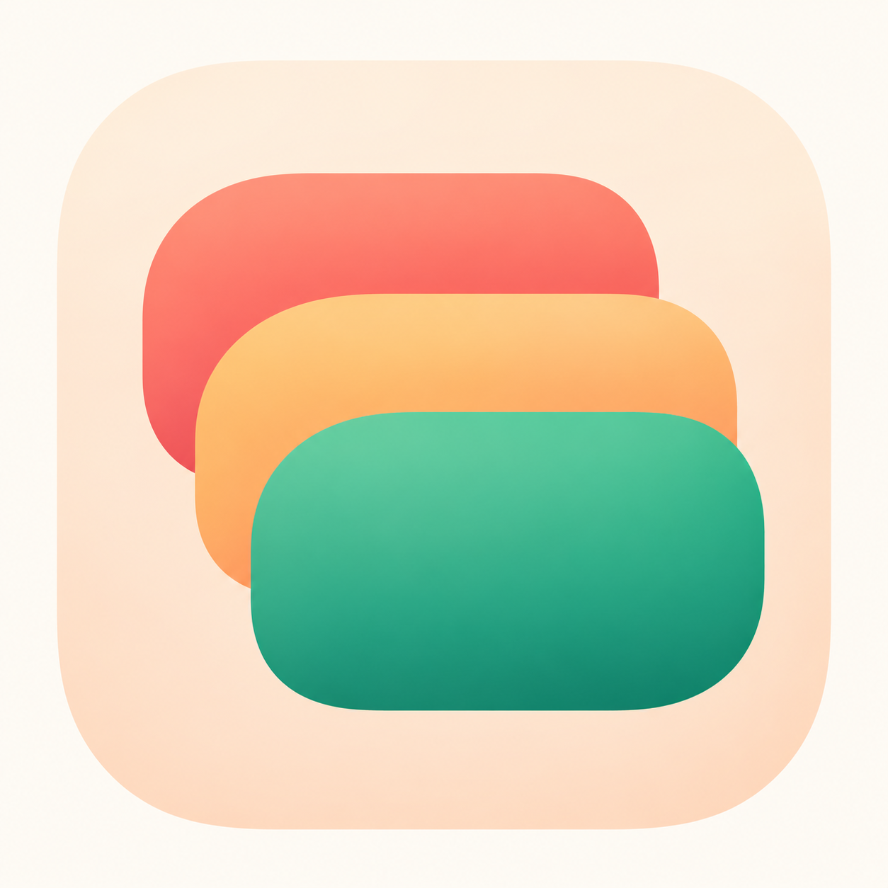
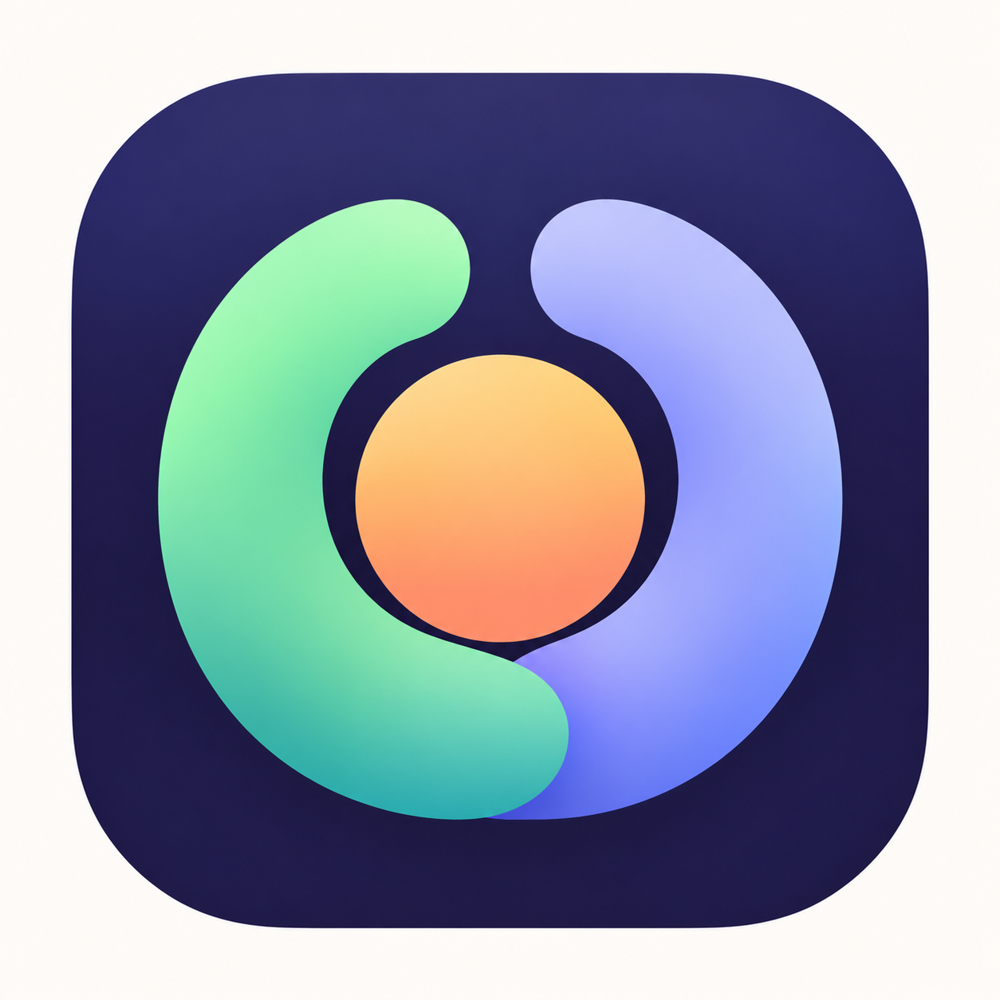

# RepHub 图标候选

日期：2026-10-11

基于本项目的个人 macOS Git / SVN 工作台用途设计。采用圆润轮廓、无描边、大色块分区与轻微渐变。以下为候选概念图，尚未接入应用或生成正式图标资源。

生成方式：内置 image_gen 工具，每个方向单独生成。完整提示词见 [prompts.md](prompts.md)。

| 01 双源叠合 | 02 柔色汇流 | 03 版本层叠 | 04 圆润 R | 05 环抱工作区 |
| --- | --- | --- | --- | --- |
|  |  |  |  |  |

## 01 双源叠合

两种来源叠合为同一个工作区。绿色与蓝色呼应 Git、SVN 的独立性和共同目录，简洁稳妥。

原图：[01-dual-source.png](01-dual-source.png)

## 02 柔色汇流

圆润流动色块汇向中心，表达 Hub 的汇集。薄荷绿与蓝紫更轻快，是本轮优先推荐。

原图：[02-soft-confluence.png](02-soft-confluence.png)

## 03 版本层叠

三个柔圆层片代表可追溯的代码版本。暖色搭配翡翠绿，亲和、直观。

原图：[03-revision-layers.png](03-revision-layers.png)

## 04 圆润 R

以大色块组成 RepHub 的 R，应用名称关联最直接，品牌辨识度强。

原图：[04-rounded-r.png](04-rounded-r.png)

## 05 环抱工作区

两片色块环抱共享工作区。深靛底色搭配薄荷、蓝紫和杏色，Dock 中较醒目。

原图：[05-workspace-embrace.png](05-workspace-embrace.png)

优先推荐 02；如果希望图标直接关联应用名称，推荐 04。当前只检查生成图的轮廓、色块与基本可辨性，尚未做真实 Dock 图标验收。
