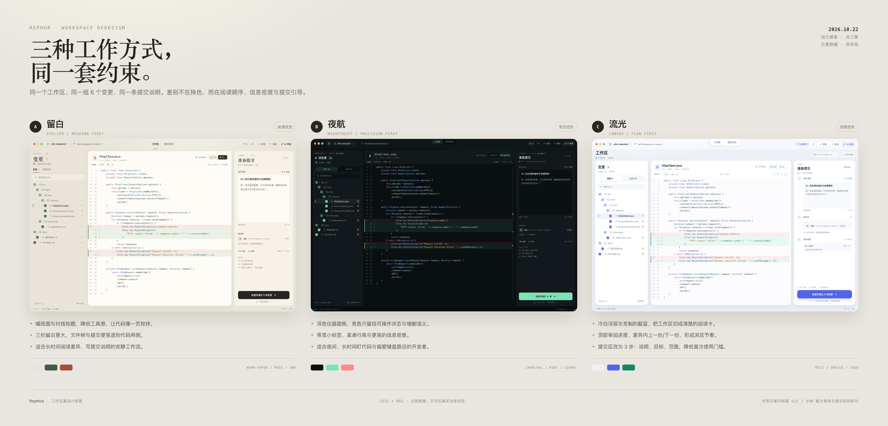
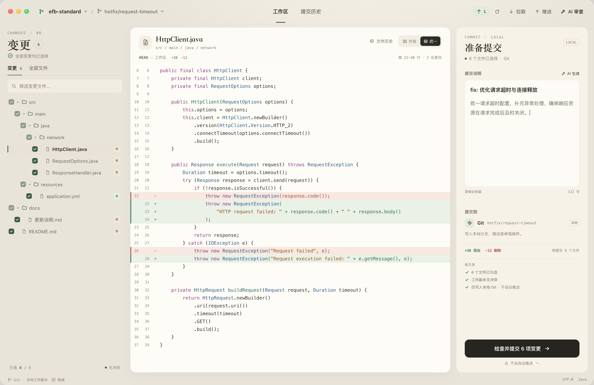
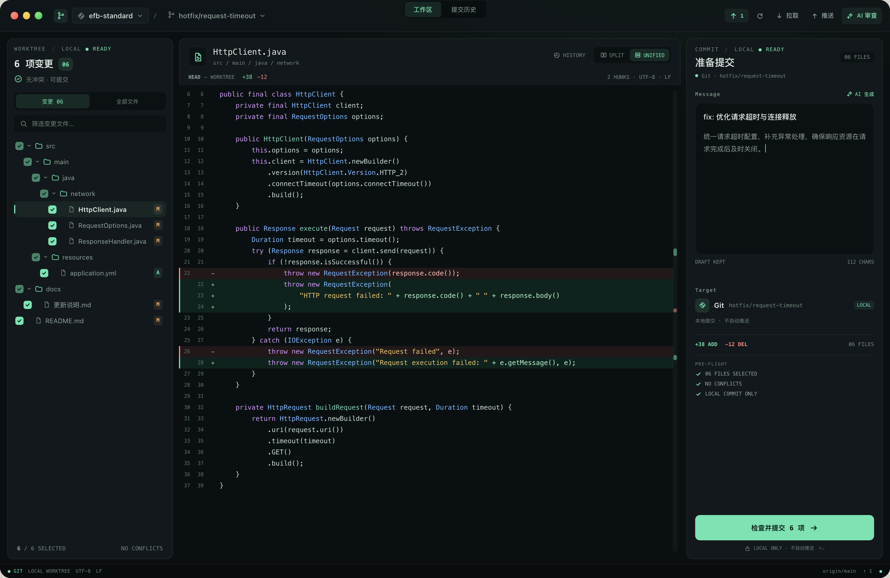
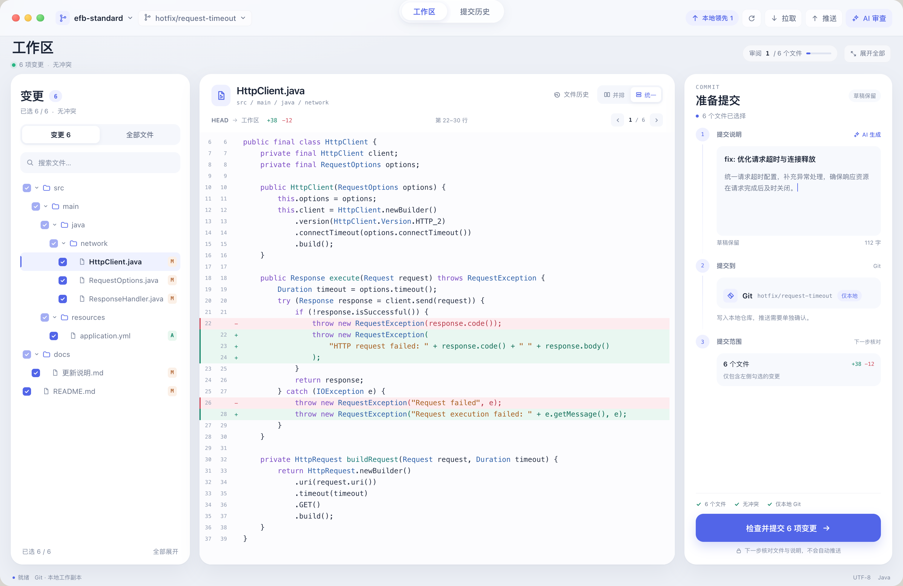

# RepHub 工作区重设计 · 三个方向

日期：2026-10-22。状态：**设计提案，未实现**。三张图由 HTML/CSS 渲染，仅用于比较方向，不替代 2026-10-16 已确认的 `soft-surfaces` 视觉基准；图中的仓库、代码、提交、分支、数量均为示意数据。

> 2026-10-22 更新：按评审意见，第二轮已收敛到 A 的空间关系，B 只保留深色配色参考，C 只吸收文件切换与目标核对。详见 [round-2/README.md](round-2/README.md)。

## 为什么选工作区

工作区是 RepHub 每天使用时间最长、信息层级最复杂的页面：文件选择、差异阅读、提交说明和 Git/SVN 目标核对都在这里发生。把它作为三案的共同画布，能比较的不只是颜色，而是三种工作方式。

三案都保留现有产品的硬约束：

- 仓库从顶部左侧入口选择，侧栏不出现全局仓库列表。
- 顶部仍是「工作区 / 提交历史」，AI 审查在右侧，不重复放设置。
- 文件树按本地变更勾选，差异保留双行号、增减语义和并排/统一切换。
- 提交主按钮进入「检查并提交」，Git 提交写入本地，推送是独立动作。
- 只展示 Git 示例；SVN 页面沿用同一套视觉，但使用「更新 / 直接提交」而不是 Git 式「拉取 / 推送」。
- 不虚构传输进度、文件统计或服务端状态。

## A · 留白（Atelier）

**一句话：把工作区做成一页可以慢慢读的校样。**

- **气质**：暖纸色、墨色正文、苔绿点缀；只在文件标题和数字上使用衬线体，中文正文保持系统无衬线，避免变成复古海报。
- **布局**：300 / 自适应 / 334。顶部导航改成下划线标签而非填充胶囊；左栏不做白卡，靠留白与轻微背景差形成区域。
- **阅读**：差异区拥有最大连续面积，行号退到很淡的暖灰；增加与删除仍是可读的浅底，而不是高饱和色块。提交区像一张便笺，说明输入框保留大面积空白。
- **提交引导**：右侧在「提交到 Git」之后增加三行轻量预检（文件已勾选 / 无冲突 / 仅本地），把「不会自动推送」放在主按钮下方。
- **适合**：长时间读代码、写说明、希望工具感更弱的用户；也最适合从当前暖灰界面渐进演进。
- **代价**：信息密度最低，第一次使用仍需要自己理解「先选文件、再写说明」的顺序；衬线标题需要严格限制字号与出现位置，否则容易显得过度设计。

**色板**：纸面 `#E9E4DA` · 内容面 `#FDFBF5` · 墨 `#292821` · 苔绿 `#3D5B49` · 删行 `#A44D3C`。

## B · 夜航（Nightshift）

**一句话：把工作区做成一台安静的深色仪器。**

- **气质**：以炭黑为底，只让薄荷绿承担状态、目标和主操作；增删仍是低饱和的深绿/深红底，避免整屏发光。
- **布局**：282 / 自适应 / 334。信息密度提高，标题、路径、计数、HISTORY 等元信息使用等宽小字；文件树行高更紧凑，提交区像一块仪表板。
- **阅读**：差异区使用近黑背景，语法色比界面色更亮；右侧增加极窄的变更位置提示条，帮助在长文件中定位 hunk（这是方向示意，不是现有功能）。
- **提交引导**：Message / Target / Pre-flight 三段式，预检使用大写等宽标签，主按钮是整屏唯一的亮色块。
- **适合**：夜间、长时间盯代码、熟悉 Git 的开发者；也最能建立 RepHub 与普通「白底工具」的辨识度。
- **代价**：作为唯一默认外观会偏重；需要同时设计一套可信的浅色反转，而不是简单反色。小号等宽标签对可访问性是风险，落地时要设置下限并允许放大。

**色板**：背景 `#0B0F11` · 面板 `#12181B` · 薄荷 `#7EE2B2` · 增 `#7CDDAD` · 删 `#FF8B84`。

## C · 流光（Canvas）

**一句话：把「看文件 → 读差异 → 检查提交」做成一条可见的路径。**

- **气质**：冷白浮层、雾蓝背景、克制的靛蓝主色；圆角更大，但内容面保持纯白，代码区不叠玻璃效果。
- **布局**：300 / 自适应 / 348，顶部多一条 64 点的页面头。左栏是白色的「变更」卡，中央差异卡最大，右栏提交区被拆成 3 步。
- **阅读**：顶部显示「审阅 1 / 6 个文件」和进度条，差异头部提供上一份/下一份，适合按文件顺序走查；左栏底部保留批量展开。
- **提交引导**：第 1 步说明、第 2 步目标、第 3 步范围；底部预检和主按钮固定在最后，降低首次使用和多来源提交时的理解成本。
- **适合**：第一次使用、需要在 Git / SVN 多个目标之间核对、希望产品更有「流程感」的用户；也最适合作为一次真正的结构升级。
- **代价**：结构改动最大，需要新增审阅进度/上一份下一份等交互，并验证它们不会干扰键盘操作；卡片和步骤增加了视觉容器，稍不注意就会变成网页仪表盘。

**色板**：雾蓝 `#EDF0F6` · 白 `#FFFFFF` · 靛蓝 `#5265E8` · 青绿 `#148568` · 删行 `#CF4B5A`。

## 横向比较

| | A 留白 | B 夜航 | C 流光 |
| --- | --- | --- | --- |
| 首要目标 | 阅读沉浸 | 专注与辨识度 | 流程清晰 |
| 代码阅读 | 最松弛 | 最紧凑 | 居中，带审阅节奏 |
| 首次使用 | 需要理解现有顺序 | 需要熟悉工具语汇 | 最容易被步骤带着走 |
| 信息密度 | 低 | 高 | 中 |
| 结构改动 | 小 | 小到中 | 大 |
| 主要风险 | 显空、衬线过度 | 作为默认过重、小字可访问性 | 容器过多、步骤变慢 |
| 建议角色 | 可渐进落地的主方案 | 深色主题 / 强个性方向 | 产品结构升级方向 |

## 我的判断

> 2026-10-22 第二轮已收回这个判断：以 A 为主线，C 只吸收当前文件导航和目标核对。以下第一轮理由保留作对照，当前建议见 [round-2](round-2/README.md)。

如果这轮只选一个方向落地，我会选 **C · 流光**：它解决的不只是「好不好看」，而是把工作区最容易被忽略的顺序——选文件、读差异、核对目标、提交——变成了看得见的路径。它也更适合 RepHub 同时管理 Git 与 SVN 的复杂背景。

但如果目标是**低风险地刷新现有产品**，A 更稳：它保留已经确认的暖灰柔和基调与三栏结构，只重做字体、留白、导航和提交便笺，SwiftUI 改动可控。

B 不建议直接作为唯一默认外观。它更适合作为一套完整的深色主题，或者在与用户确认「深色优先」后再升级为主方案；否则会丢掉当前产品最容易接近的温和感。

## 如果继续

> 注：这一节保留第一轮的比较思路；第二轮的收敛动作见 [round-2](round-2/README.md)。

1. 先选方向，再定「仅视觉」还是「允许改结构」。
2. 选 A：优先落 Design tokens、顶部导航、左栏留白、提交便笺与预检；不改现有工作流。
3. 选 B：先做浅色/深色两套完整 token，确认小字下限和代码配色独立设置，再替换默认主题。
4. 选 C：先做一个可运行的 SwiftUI 原型，只验证「审阅进度 + 三步提交」；确认不增加高频用户的操作步数后，再改正式界面。
5. 三案都应在真实窗口宽度、窄分栏、深浅外观、代码配色交叉组合下复核，不能只看 1512 × 982 的图。

## 文件

- [三案总览](00-overview.png)
- [A · 留白](01-atelier.png)
- [B · 夜航](02-nightshift.png)
- [C · 流光](03-canvas.png)
- 可复现源文件：`src/index.html`、`src/styles.css`、`src/app.js`、`src/overview.html`、`src/render.mjs`
- 重新渲染：`node docs/design/redesign-2026-10-22/src/render.mjs`

> 说明：以上均为设计提案。未修改 SwiftUI 界面、未改动仓库数据、未执行任何版本控制写操作。正式实现前仍需按 `docs/design/soft-surfaces-2026-10-16/` 的已确认基准做差异评审。
