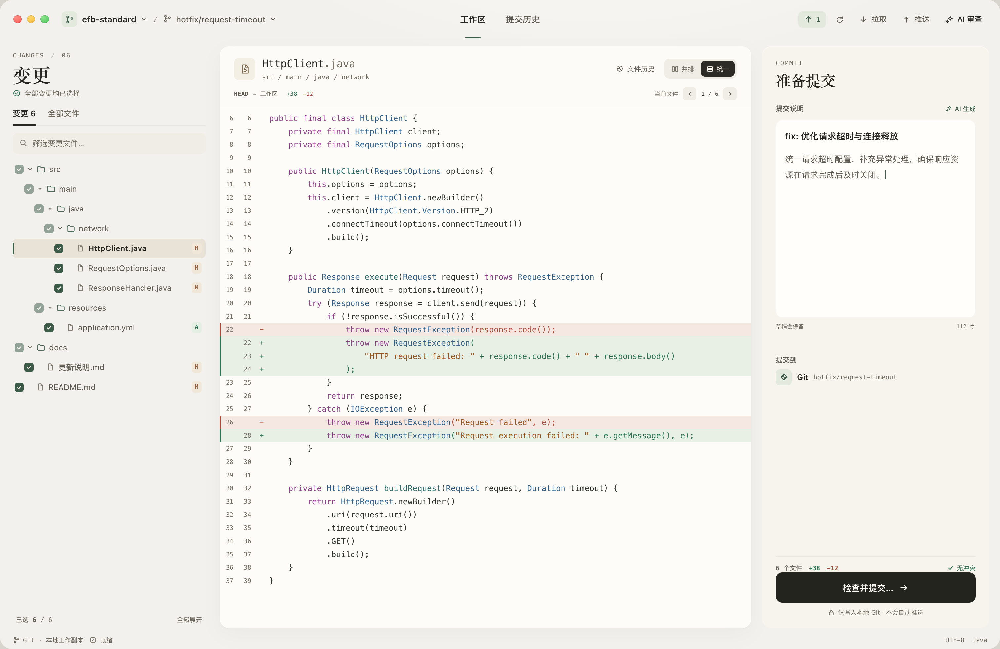
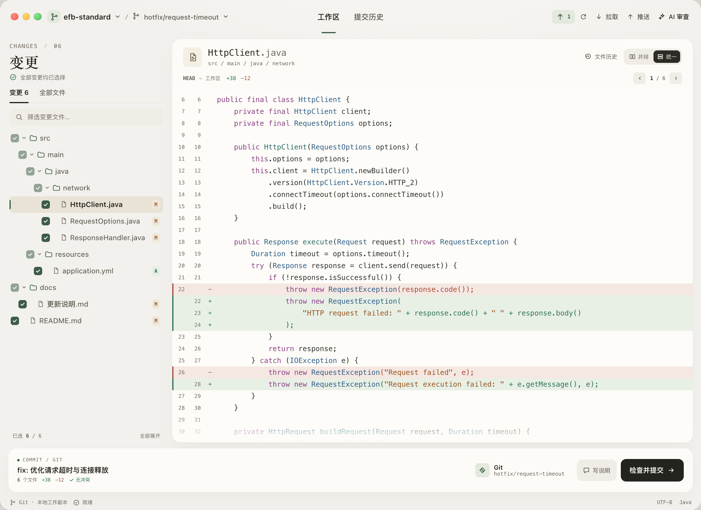
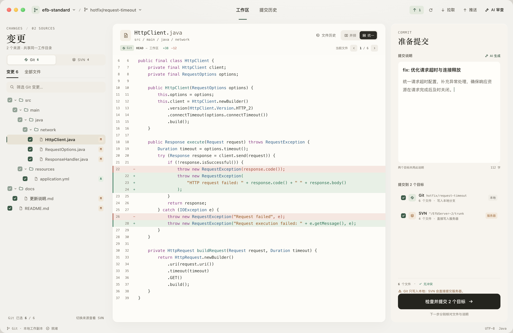

# A2 · 按评审收敛

日期：2026-10-22。状态：**第二轮设计提案，未实现**。这一轮不再提供三选一，而是在上一轮 A 的空间关系上收敛；B 只保留深色配色参考，C 只吸收文件切换与目标核对。图中仍为示意数据。

## 先回应评审

评审的核心判断我认可：上一轮把「流程清晰」等同于「结构更多」，C 的标题、卡片和步骤线确实把成本转嫁给了代码阅读。A 的克制更接近 RepHub 已有的暖灰柔和方向，也更适合作为主界面继续打磨。

但 A 原稿也有明显问题，这一轮逐项处理：

| 评审问题 | A2 的处理 |
| --- | --- |
| 米黄偏重 | 画布从 `#E9E4DA` 收到接近中性的 `#F2F1ED`，内容面 `#FCFBF7`；保留暖意，不再像纸张主题 |
| 辅助文字过淡 | 次级文字从 `#847C6D` 加深到 `#5E5A51`，元信息用 `#6F695E`；在 `#F2F1ED` 上对比度约 4.8:1，路径、时间、计数可扫读 |
| 衬线文件名 | 文件名改为 SF Mono 16，路径继续等宽；衬线只保留在「变更」「准备提交」这类版面标题上 |
| C 的重复标题和卡片 | 不采用 C 的页面标题、步骤编号、步骤线、嵌套容器；保留 A 的单层三栏 |
| 重复提示 | 去掉独立的预检三行；文件数、增删和“无冲突”合并为提交区底部的一行摘要；“仅本地、不推送”只出现一次 |
| “审阅 1/6”含义不清 | 改为“当前文件 1/6”，只表示当前查看位置，不声称已审阅，也不维护已审阅计数 |
| 只展示简单状态 | 新增窄窗和 Git/SVN 双目标两张状态图；双目标显示不同提交范围 |

## 主工作区

- 三栏比例 300 / 自适应 / 344，和 A 一致；代码区仍是最大连续阅读面。
- 文件名改为等宽体，路径退到 9.5 点；顶部导航保留 A 的下划线标签，不再使用填充胶囊。
- 左栏不再重复显示“无冲突”，提交摘要只在右侧出现一次：`6 个文件 · +38 −12 · 无冲突`。
- 提交按钮只写「检查并提交…」，不再把文件数塞进按钮；范围在上方摘要中已经说明。
- 文件切换控制在差异头部：`当前文件 ‹ 1 / 6 ›`。这是一个位置指示，不是进度条。

## 窄窗 1180 × 860

- 右侧提交检查器折叠成底部 74 点摘要条：提交说明、文件数/增删/冲突、Git 目标、写说明、检查并提交都在一条线上。
- 中央差异拿到完整宽度；不再为了保留右栏把代码压到 500 多点。
- 点「写说明」恢复完整提交区；折叠不等于丢弃草稿。
- 左栏仍保留文件树和选择框，长文件名在当前宽度下完整显示；更窄的 1024 窗口仍需单独验证。

## Git / SVN 双目标

- 左栏顶部出现来源切换：`Git 6` / `SVN 4`；文件树只展示当前来源，底部说明「Git 已选 6 / 6」。
- 右侧一次列出两个提交目标，各自带勾选、路径、文件数和提交方式：
  - Git：`hotfix/request-timeout`，6 个文件，写入本地分支。
  - SVN：`^/EfbServer-J/trunk`，4 个文件，直接写入服务器。
- 两个目标共用同一份提交说明，底部说明「下一步分别核对文件与说明」；不在这个页面伪造分别编辑。
- 只保留一次风险提示：`Git 只写入本地；SVN 会直接提交服务器。`
- 6 个文件是去重后的工作区文件数；Git 6、SVN 4 是各自目标范围，不能相加成 10。

## 与上一轮 A 的对比

| | A | A2 |
| --- | --- | --- |
| 画布 | 偏米黄 `#E9E4DA` | 中性暖灰 `#F2F1ED` |
| 文件名 | 衬线 20 点 | 等宽 16 点 |
| 辅助文字 | 偏淡 | 加深一级，路径和计数可读 |
| 提交区 | 三行预检 + 统计 + 本地提示 | 一行提交摘要 + 一次本地提示 |
| 文件切换 | 无 | 当前文件 1/6，无“已审阅”含义 |
| 复杂状态 | 单 Git、无冲突 | 窄窗、Git/SVN 双目标、不同范围 |

## B 的记录

B 不作为这一轮的布局或字号基准，但深色配色仍可保留为完整主题：

- 背景 `#0B0F11`、面板 `#12181B`、薄荷 `#7EE2B2`、删行 `#FF8B84`。
- 若落地为深色主题，代码字号不低于 12.5 点，元信息不低于 9.5 点；减少整段大写英文，保留中文和等宽数字。
- 深色与浅色共享同一套布局、尺寸和间距，不单独缩小字号。

## 这一轮没有解决的问题

- 目前仍是静态设计稿；键盘路径、焦点顺序、VoiceOver、动态字号和真实对比度都未验证。
- 只验证了 1512 和 1180 两个宽度，未验证 1024、超宽屏、系统放大字体。
- 双目标页只呈现“两个目标都选中”的常态，冲突、部分失败、各目标分别填写说明仍留在现有预检窗口处理。
- 文件再次修改后，“当前文件”位置保持不变，也不会自动标记为已审阅；这是刻意的，避免制造虚假的检查状态。
- 顶部 AI 审查、拉取/推送和文件历史只是版面上的现有入口，没有重新定义它们的交互。

## 建议的下一步

1. 先确认 A2 的空间关系和提交摘要，不急着做完整实现。
2. 用真实窗口验证 1512 / 1280 / 1180 / 1024 四档，补冲突状态和 Git/SVN 只选一个目标的变体。
3. 把 A2 的颜色、字号、间距映射到现有 `DesignSystem`，先做只读页面，再接入真实 `WorkspaceModel`。
4. 为「当前文件」补键盘快捷键与 VoiceOver 描述；不引入“已审阅”状态，除非能定义文件修改后的失效规则。
5. 继续用 B 的色板做深色主题实验，但不要用 B 的小字号布局作为默认。

## 文件

- [A2 主工作区](01-a2-workspace.png)
- [A2 窄窗](02-a2-narrow.png)
- [A2 Git/SVN 双目标](03-a2-dual-target.png)
- 源文件：`src/index.html`、`src/v2.css`、`src/app.js`、`src/render.mjs`
- 重新渲染：`node docs/design/redesign-2026-10-22/round-2/src/render.mjs`

> 说明：本文件是设计提案，不是实现记录。未修改 SwiftUI，未对任何仓库执行写操作。
